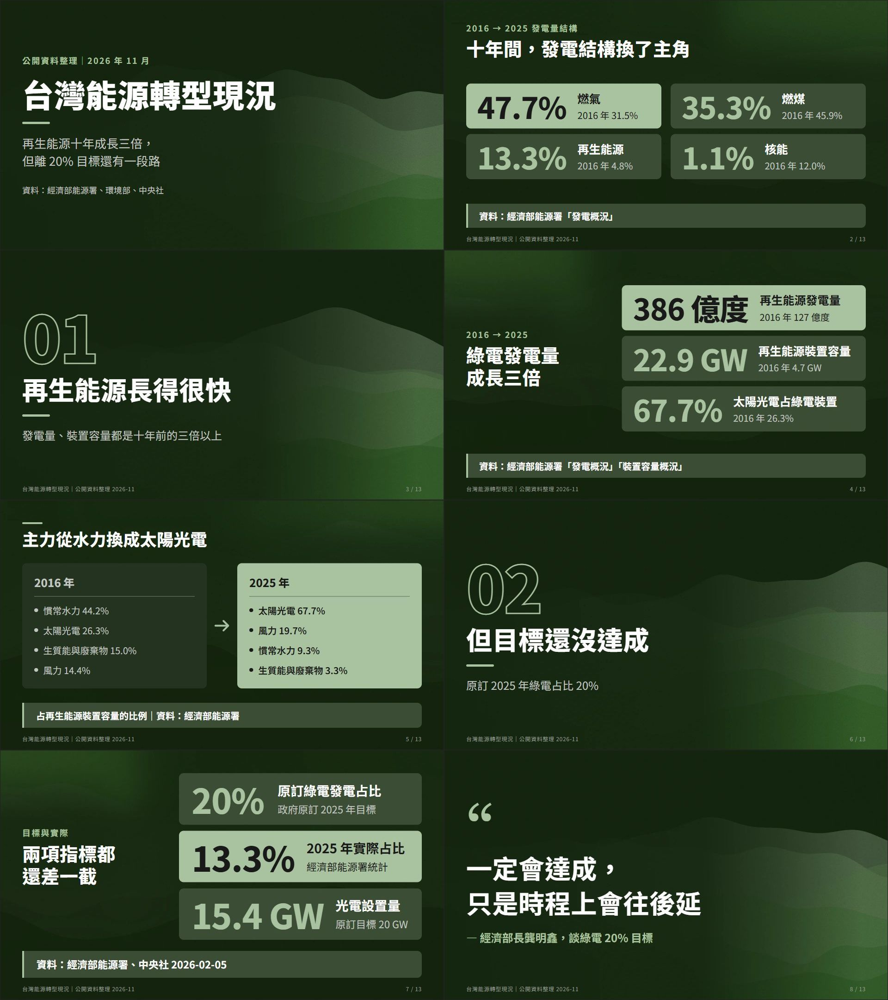

# html-deck 案例

用 [html-deck](https://github.com/slidefirm/html-deck-skill) 做出來的簡報。每個案例都附上原始的內容表（JSON），
成品 HTML 完全由內容表自動排版產生，沒有手動調整。

## 台灣能源轉型現況（2026-11）

[線上觀看](https://slidefirm.github.io/html-deck-examples/taiwan-energy-2025/)｜[內容表](taiwan-energy-2025/taiwan-energy.deck.json)



13 頁，整理經濟部能源署、經濟部電力供需報告、環境部能源資訊平台與中央社的公開資料：
十年間發電結構的變化、再生能源的成長、與 20% 目標的落差，以及接下來的用電壓力。
每頁的數字都在頁面上標了出處。

打開網頁就是編輯模式，可以直接拖拉物件、改字、匯出 PPTX；按右上角「投影」或 `E` 播放。

## 自己重做一次

裝好 html-deck 之後，在 Skill 資料夾裡：

```bash
node scripts/build.mjs <這個儲存庫>/taiwan-energy-2025/taiwan-energy.deck.json -o index.html
```
